# 2J-092 browser evidence

All images were captured from the local `@2j/client-app` Vite server in an isolated headless Chromium session. The preview fixture is fictional. The preview build was opened with `?preview=1` and made zero API requests. For the separate interactive journey, Playwright intercepted the app API with deterministic synthetic responses; it captured one Member explicitly selecting three sessions, confirming two reservations and one waitlist entry, then returning to Inicio. Actual API/eligibility mutations were independently covered by the 185 PostgreSQL integration tests.

The viewport measurements report `window.innerWidth × window.innerHeight`. Chromium's vertical scrollbar reduces the CSS layout client width by 15 px where shown; `documentElement.scrollWidth` equaled `clientWidth` in each check, so there was no horizontal overflow.

## Responsive home

| View | Evidence |
| --- | --- |
| 390×844 | 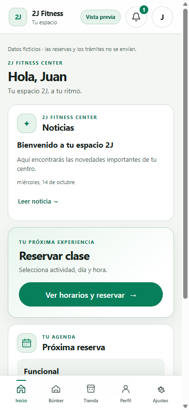 |
| 768×1024 | 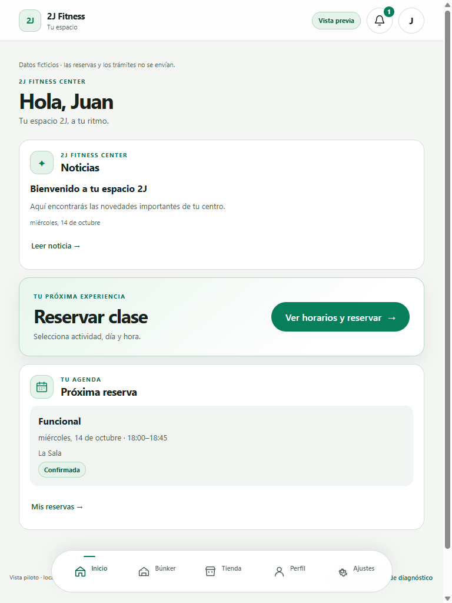 |
| 1440×900 | 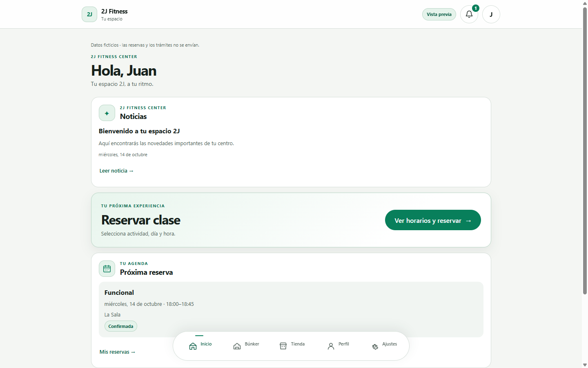 |

Measured inner viewport sizes were exactly 390×844, 768×1024, and 1440×900. All had zero horizontal overflow.

## Light and dark booking flow, 390×844

| State | Light | Dark |
| --- | --- | --- |
| Service selection | 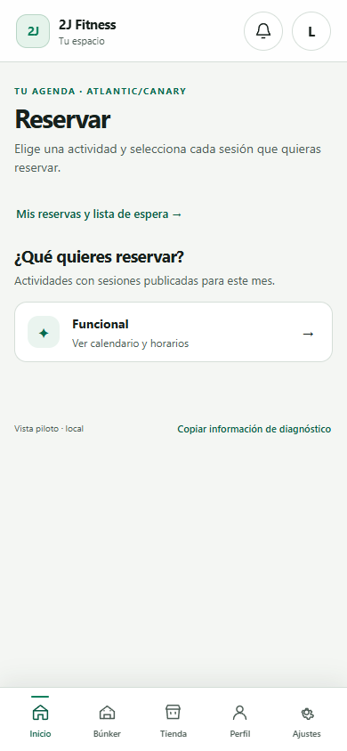 | 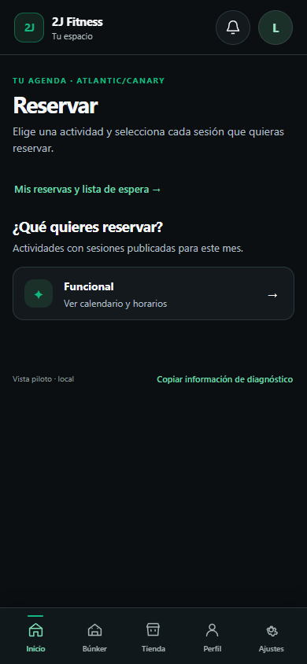 |
| Month and selected day | 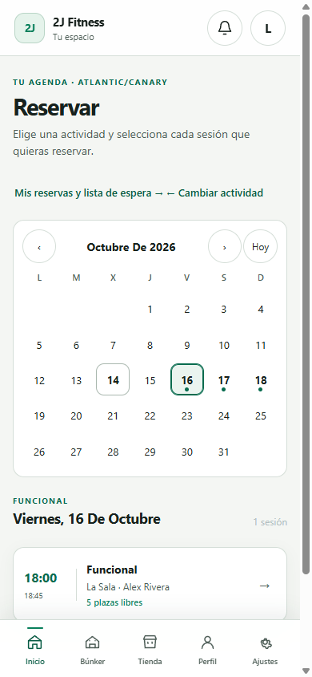 | 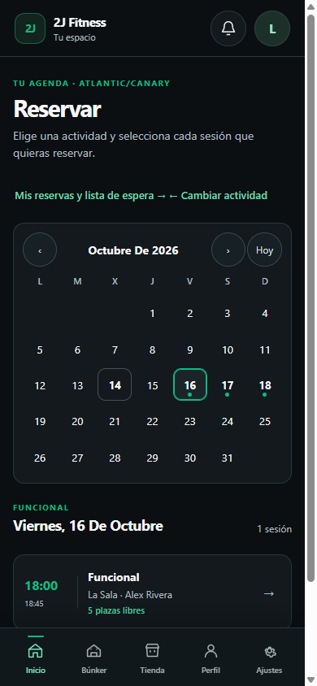 |
| Session list | 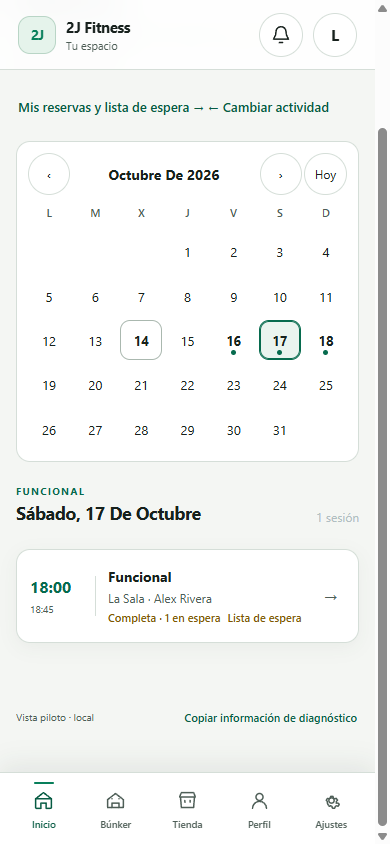 | 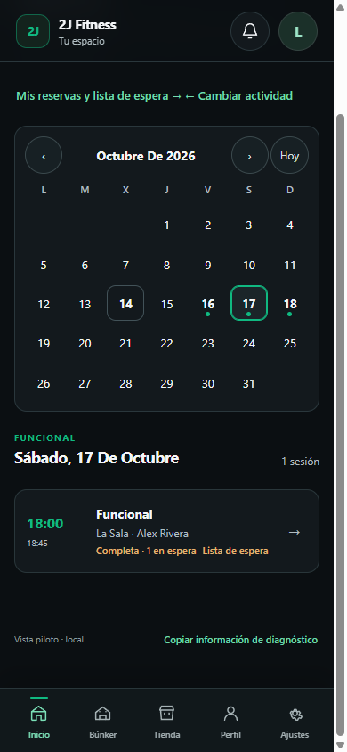 |
| Explicit confirmation of three individually chosen sessions | 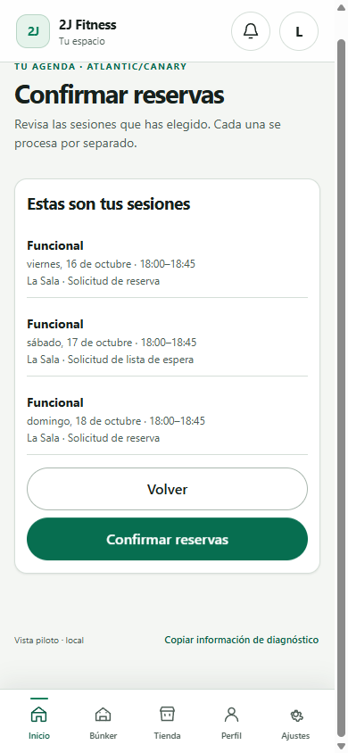 | 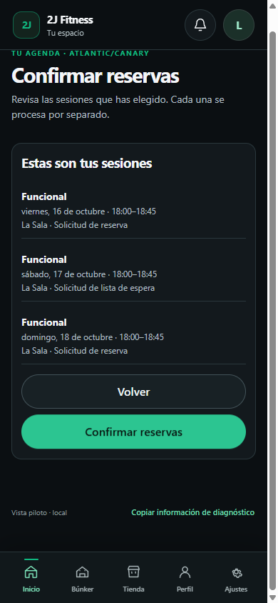 |
| Independent booking/waitlist outcomes | 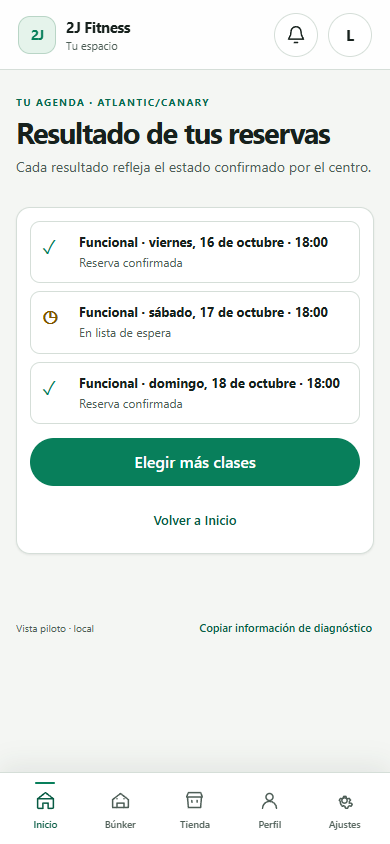 | 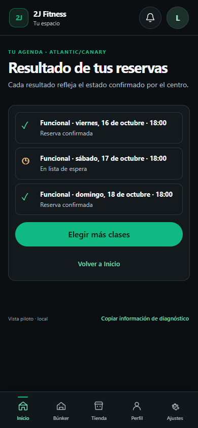 |
| Reservation cancellation confirmation | 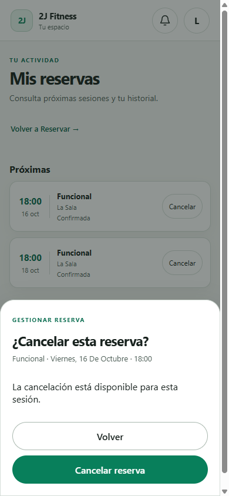 | 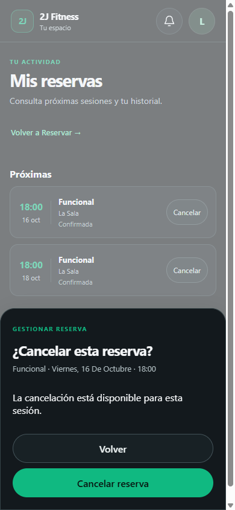 |

The synthetic journey submitted the selected dates individually: two confirmed reservations and one waitlist request, each with a different idempotency key. The result screen keeps the waitlist distinct. Inicio then showed the nearest confirmed reservation and excluded the waitlist entry.

The preview-only screenshots use local fixture data, including a confirmed reservation. They never call the API; selection and confirmation review work locally, while the final mutation remains disabled in preview.

## Review notes

- Both themes use the same Hub layout and remain readable after correcting theme-selector specificity in the Hub root and shared session/cancellation dialog.
- The browser checked the real dialog role and native button controls; tests additionally cover cancellation confirmation, explicit waitlist choice, human-readable eligibility feedback, disabled booking-gate action, and zero Member recurrence wording.
- The browser journey used intercepted synthetic API responses to make visual acceptance repeatable. The full PostgreSQL API suite covers real self-scoped identity, eligibility, reservation, waitlist, cancellation, concurrency, and audit behavior.
- No recurrence is exposed or created by the Member flow. Admin/Staff recurrence remains outside this change.
