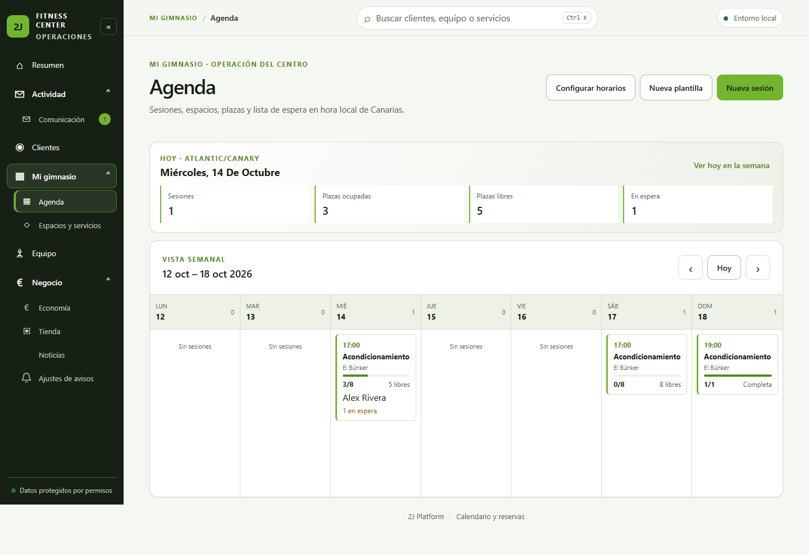
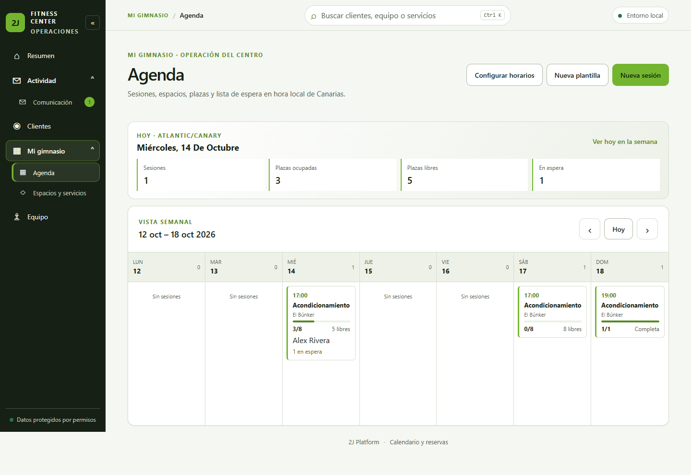
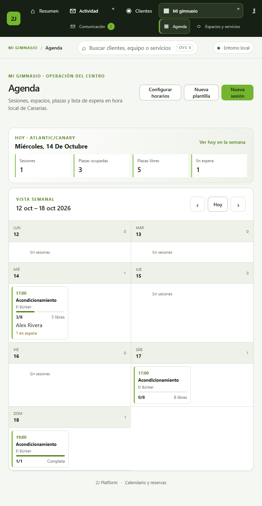
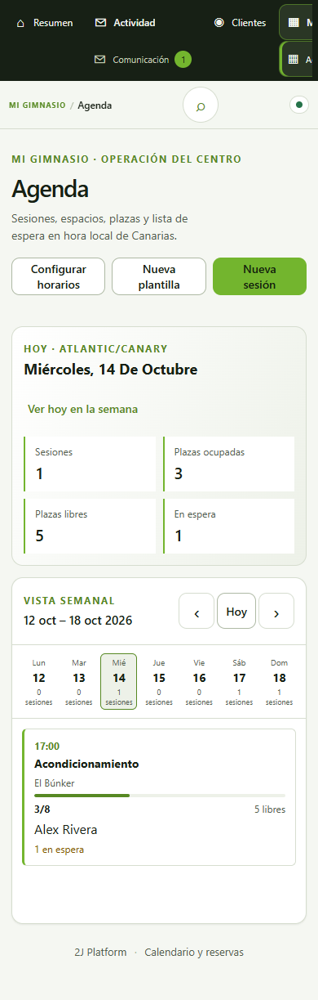
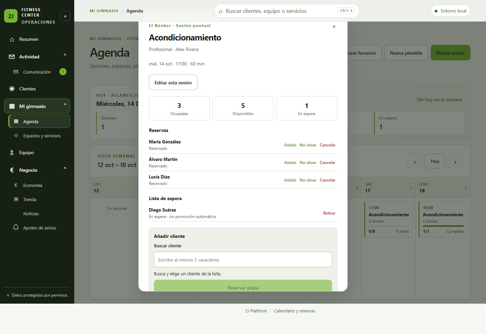
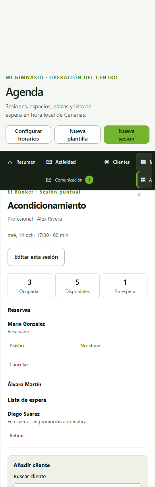
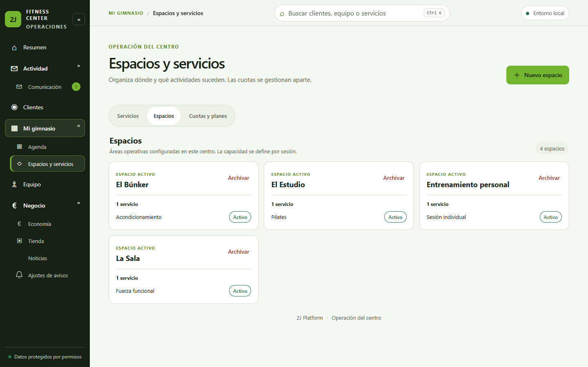
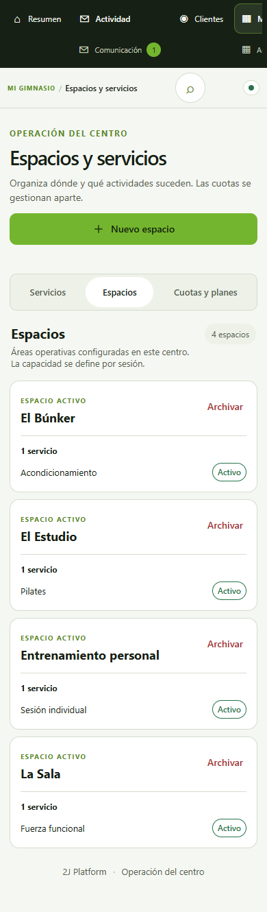
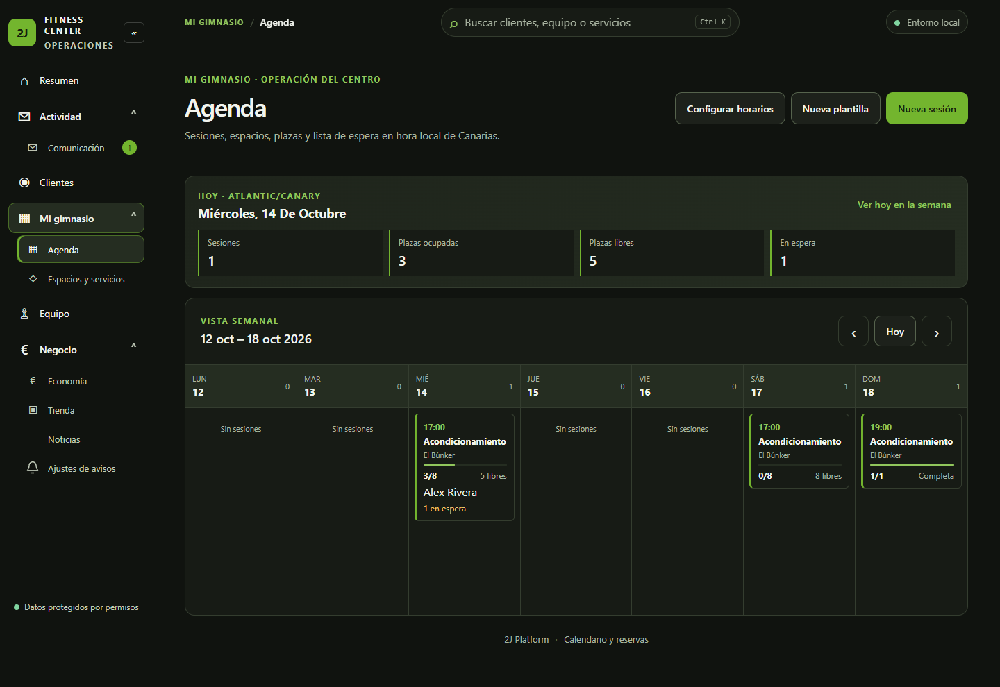
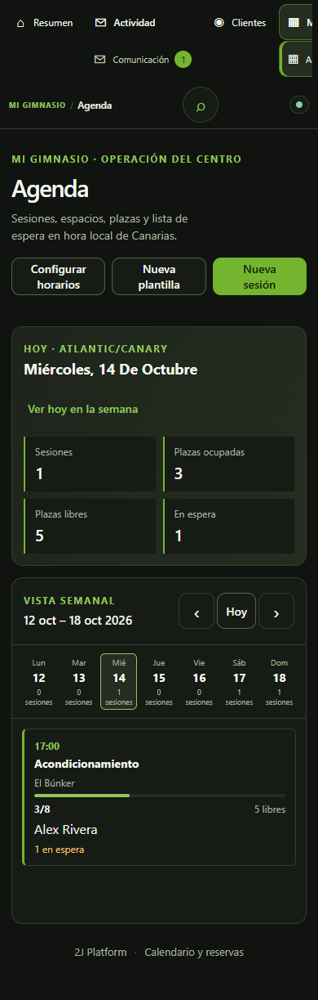

# Evidencia 2J-097 — Mi gimnasio

## Método y datos

Capturas de un navegador Google Chrome real controlado mediante Playwright/CDP, con `apps/admin-web` servido desde Vite y dos procesos API independientes: Admin y Trainer. Ambos usan una instancia PostgreSQL local y desechable, aislada en Docker/loopback. Solo se cargó el seed sintético `2J-070`; no hay datos reales ni conexión con Training o `2jfitnessapp`.

Base funcional antes de la documentación de handoff: `fe8e76038b8caa7327cd75ac114e4448aa5dcc90`. El SHA de entrega se publica en el PR; las imágenes corresponden al working tree validado de esta TASK.

## Capturas

### Admin — Agenda, claro, 1440×900

### Trainer — Agenda, claro, 1440×900

### Agenda, claro, 768×1024

### Agenda, claro, 390×844

### Detalle de sesión, 1440×900 y 390×844

### Espacios dinámicos — cuatro áreas, 1440×900

### Espacios, 390×844

### Modo oscuro con tokens 2J

## Medición y accesibilidad

- `document.documentElement.scrollWidth`: 1440 en viewport 1440, 768 en viewport 768 y 390 en viewport 390; no hay desbordamiento horizontal del documento.
- En 390 px, búsqueda, controles anterior/siguiente, acción “Ver hoy en la semana” y tabs de espacios miden al menos 44×44 px o 44 px de alto.
- La sesión es un botón nativo con nombre accesible y foco visible. Enter abre el diálogo de detalle; Escape cierra y devuelve foco a la sesión.
- En vista Trainer la API y la interfaz omiten precios y secciones de economía/tienda. En el detalle de participante solo se exponen nombres y estados operativos; no hay email, teléfono, fecha de nacimiento, finanzas, salud o métricas de Training.
- Los tests cubren estados de carga, error, vacío, reintento, permisos y respuestas API. No se fabricaron capturas de estados que no estaban visibles en la ejecución.

## Contenido sintético observado

La agenda incluye una sesión con 3/8 plazas y una persona en espera, una sesión libre con 0/8 y otra completa con 1/1. El catálogo de ejemplo relaciona cuatro espacios con cuatro servicios. Esto prueba que la UI usa la colección configurable y no se limita a tres nombres fijos.
