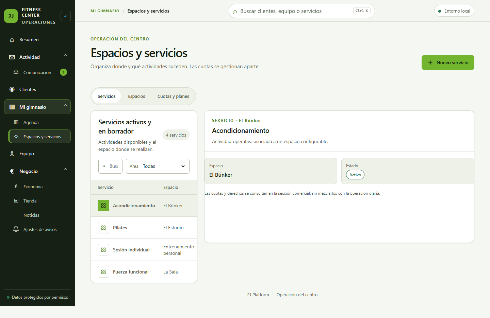

# Evidencia 2J-097 — Mi gimnasio

## Método y datos

Capturas de Google Chrome real controlado mediante Playwright/CDP, con `apps/admin-web` en Vite y APIs locales separadas para Admin y Trainer. Ambas usan PostgreSQL local desechable en Docker/loopback y el seed sintético `2J-070`. No se usaron datos reales, Training ni `2jfitnessapp`.

- Base `origin/main`: `fe8e76038b8caa7327cd75ac114e4448aa5dcc90`.
- Head funcional exacto de las capturas: `95362c99c1b90f5e90987fafd0d45c37592bc01f`.
- El único delta previsto después de ese head es documentación de TASK/handoff/evidencia; el SHA final se publica en el PR.

## Capturas

### Admin — Agenda, claro, 1440×900

### Trainer — Agenda, claro, 1440×900

### Agenda, claro, 768×1024

### Agenda, claro, 390×844

### Detalle de sesión, 1440×900 y 390×844

### Servicios y relación con espacios, 1440×900

### Espacios dinámicos — cuatro áreas, 1440×900 y 390×844

### Modo oscuro con tokens 2J

## Medición y accesibilidad

- `document.documentElement.scrollWidth`: 1440 en viewport 1440, 768 en viewport 768 y 390 en viewport 390; sin desbordamiento horizontal del documento.
- A 390 px, búsqueda, anterior/siguiente, “Ver hoy” y pestañas internas miden al menos 44×44 px o 44 px de alto.
- La tarjeta de sesión es un botón nativo con nombre accesible y foco visible. Enter abre el diálogo; Escape cierra y devuelve foco.
- Trainer no recibe precio base en `/api/services/:serviceId/plans` y no ve Economía, Tienda ni Cuotas y planes. El detalle de sesión solo expone nombres y estados operativos; no email, teléfono, DOB, finanzas, salud o métricas Training.
- Los tests automatizados cubren estados de carga, error, vacío y reintento, además de permisos y respuestas API. No se fabricaron capturas de estados que no estaban visibles.

## Datos sintéticos visibles

La agenda muestra una sesión ocupada con 3/8 plazas y una persona esperando, una sesión libre con 0/8 y una completa con 1/1. El catálogo relaciona cuatro espacios con servicios; la UI no depende de nombres de salas fijos.
