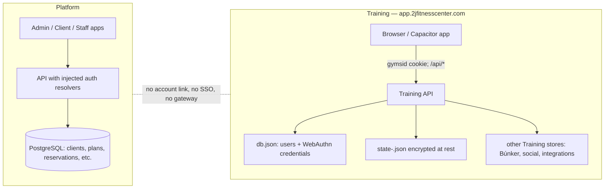
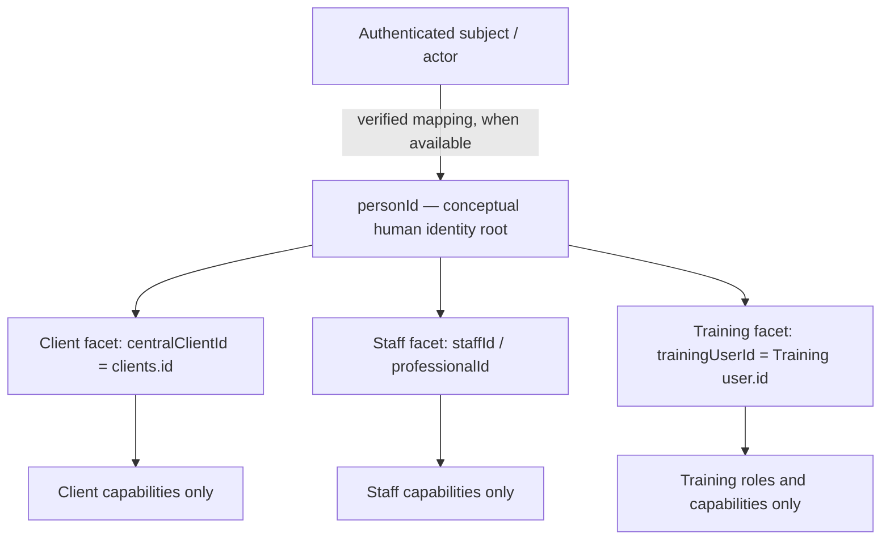
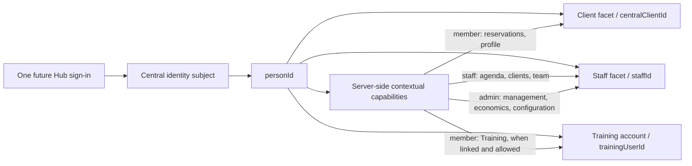

# 2J-078A — Platform ↔ Training integration map

**Status:** discovery complete; design only. **No integration is implemented.**

**Platform snapshot audited:** `fc97458100b45db51475b37470e75cf2bb76d687` (`origin/main`, verified against the remote on 2026-10-10).

**Training snapshot audited:** `d1ea376d4834fb5ba7b419c9315a926e64a9cab4`, branch `codex/android-rest-alert-integration`, checkout `C:\Users\juanj\Desktop\APP de Entrenos 2JFitness`. This is a point-in-time observation, not a pinned dependency.
**Timezone for operational examples:** `Atlantic/Canary`.

## Executive finding

The two applications have distinct identities, authentication systems, persistence, and domain ownership today. Platform has UUID client records and management domains; Training has a random internal user id, WebAuthn passkeys, a signed host-local session cookie, and an encrypted per-user state file. Platform's authentication resolver is an injected runtime boundary and defaults to unauthenticated; its client self-service resolver is also injected. There is no current cross-product identity link, SSO, entitlement bridge, Training summary gateway, or cross-database access. Existing `training.read` and `health.read` permissions are authorization vocabulary for future Platform surfaces, not proof that a Training data integration exists.

The safe target is a conceptual central human identity, `personId`, distinct from product/domain identifiers. `clients.id` remains the commercial/operational client-facet identifier (`centralClientId`), Training `user.id` remains the Training subject (`trainingUserId`), and staff/professional identifiers remain their own facet identifiers. A separately audited link maps the existing Training identity to `personId` only after proof of control of both accounts. Training retains passkeys and all Training-owned information. Platform remains owner of membership, plans/rights, reservations, billing, staff, forms, communications and notifications. Any future cross-product data is a narrow, versioned API DTO, never a shared database, copied Training state, or implicit profile sync.

No email or phone is collected in Training's current public registration flow. Names, handles, and contact details must not be used to silently merge accounts. Existing passkeys can remain usable if the account and RP ID remain unchanged; they are not portable credentials that can be copied into a new identity provider.

## Scope and evidence method

This is a static read-only audit. Training's tracked and untracked working changes were present at the start. No Training tests, scripts, deployment tasks, or state-changing commands were run. References below are source paths and functions as observed at the exact SHAs above. This document intentionally avoids quoting private user records, `.env`, database contents, or local `data/` values.

### Audited Training code/document references

| Concern | Source evidence |
|---|---|
| User and credential store; WebAuthn registration/login; session verification and `/api/me` | `api/server.js`: `db` initialization, `register/options`, `register/verify`, `login/options`, `login/verify`, `readSession`, `sessionCookie`, `GET /api/me` |
| WebAuthn origin allow-list and Android origins | `api/lib/webauthn-origins.js` |
| Training state encryption and persistence | `api/lib/state-store.js`: `stateFile`, `readState`, `writeState` |
| Sync V2 operations, receipts, revision/generation conflicts and tombstones | `api/lib/sync.js`; `frontend/src/lib/sync-client.js` |
| Legacy full-state path and merge protections | `api/server.js`: `GET/PUT /api/data` |
| Current state keys and profile/Health fields | `frontend/src/store/useStore.js`; `frontend/src/views/Profile.jsx`; `frontend/src/lib/health.js`; `frontend/src/lib/health-v2.js`; `frontend/src/lib/measurements.js`; `frontend/src/lib/health-bridge.js` |
| Búnker check-in, session, active-workout and finish | `api/bunker/routes.js`; `api/bunker/store.js`; `frontend/src/views/Bunker.jsx`; `frontend/src/lib/bunker-persistence.js` |
| Training and guided programs | `api/lib/guided-routes.js`, `api/lib/guided-store.js`, `frontend/src/views/GuidedPrograms.jsx`, `frontend/src/store/useStore.js` |
| WHOOP and Strava integrations | `api/whoop/routes.js`, `api/strava/routes.js`; related config and client modules |

### Audited Platform code/document references

| Concern | Source evidence |
|---|---|
| Platform API bootstrap and unresolved runtime auth boundaries | `apps/api/src/server.ts`: authorization/client-authorization resolver wiring, loopback-only runtime checks, local demo resolver |
| Session claim validation contract (not a configured production login provider) | `packages/auth/src/index.ts` |
| Client record and PII permissions | `apps/api/src/clients.ts`; migrations `0002_clients.sql`, `0003_client_identity_safety.sql` |
| Client App self-service resolver derives its subject from the authenticated context | `apps/api/src/client-app.ts` |
| Rights, plans and effective entitlements | `apps/api/src/entitlements.ts`, `apps/api/src/client-plans.ts`, `apps/api/migrations/0016_client_plan_assignments.sql`, `0017_entitlements_v2.sql`, `0018_service_access_requires_target.sql` |
| Reservations, sessions and waitlist | `apps/api/src/calendar.ts`, `apps/api/src/booking-eligibility.ts`, `apps/api/migrations/0004_calendar_bookings.sql`, `0019_booking_engine.sql` |
| Role permissions and capability vocabulary | `packages/permissions/src/index.ts`, `packages/permissions/role-permissions.json` |
| Client 360 modules and per-domain summary gating | `apps/api/src/clients.ts` (`sectionDefinitions`, `summaryDomains`) |
| Staff identity references | `apps/api/src/staff.ts`, migration `0008_staff_team_timeclock.sql` |
| Current product-level client shell | `apps/client-app/src/client-app.tsx` |

## 1. Current architecture



The applications deploy separately and have separate origin/host configuration, secrets, API processes, and stores. Training's backend is a Node HTTP API with JSON-file stores; `state-<uid>.json` is encrypted at rest by `api/lib/state-store.js`. Platform uses PostgreSQL, SQL migrations and permission-aware APIs. The audited Platform API is loopback-only unless an approved runtime resolver is provided; the default resolver returns `null`. Treat both as separate deployables and availability domains.

## 1A. Proposed central person and independent facets

This is a conceptual recommendation for a later TASK, **not an implemented schema or accepted product decision**. 2J-078A introduces no `people` table, `personId`, identity provider, or cross-system link.



One human may have zero, one, or several facets/accounts: client only, staff only, client plus staff, client plus staff plus Training, or future combinations.
Illustrative relationships only; neither names nor schema are final:

```text
people: id=personId, status, created_at, updated_at
client facet: clientId=centralClientId, personId
staff facet: staffId/professionalId, personId
external account link: id, personId, provider/domain=training,
  remote_subject_id=trainingUserId, status, proof_method, verified_at, link_version
```

Example identifiers `personId=PERSON-1`, `centralClientId=CLIENT-15`, `staffId=STAFF-4` and `trainingUserId=abc123` can all refer to one human while keeping separate namespaces.
### Future Hub identity and capability view



This shows one human identity with separately authorized contexts, not shared roles or a final UX selector design. Capabilities, not duplicate accounts, determine which context/actions are available.

`personId` is the conceptual cross-facet identity root; it must not be represented by `clients.id`, `staff.auth_actor_id`, or Training `user.id`. `centralClientId` remains the identifier for client-domain records such as memberships, reservations, payments and Client 360. Existing client-only workflows continue to use it. A future account-link foundation should associate client and staff facets to a person rather than make the client facet the root; this avoids re-rooting identity if a client later becomes staff or trainer.

### Identity and authorization are separate

The conceptual relation is `authentication subject → verified personId → zero or more domain facets`. Authentication proves control of an account/session; `personId` represents one linked human; each bounded context separately grants capabilities against its own resources. A future Hub session can expose member actions (reservations, Training, profile), staff actions (agenda, clients, team) and admin actions (management, economics, configuration) only when the corresponding server-side capabilities allow them. This illustrates capability-based availability only; it does not prescribe final selector UX. Linkage never copies permissions. A Training `admin` or `trainer` role grants no Platform role, and Platform Trainer/Reception/Management/Admin capabilities grant no Training role. Authorization remains contextual and server-side.

Current `staff.auth_actor_id` is an authentication actor/subject reference, not a canonical human id. If staff is linked later, resolve that actor to `personId` through an explicit verified identity mapping, then link the existing Training `trainingUserId` to that same person after fresh proof of both accounts. Do not equate an auth subject to `personId` because their values happen to match; never link by name, email, phone, or role.

### Profile ownership

Keep any future person record minimal: `id` (`personId`), lifecycle `status`, `created_at`, `updated_at`, verified identity/link metadata and only canonical attributes required to identify the human. These identity-person attributes are distinct from domain display attributes. Client contact, commercial and membership fields remain client-facet data; staff employment/professional and operational attributes remain staff-facet data; Training display name, username, avatar and preferences remain Training-owned. Names may intentionally differ across products; do not silently synchronize profile fields or bidirectionally sync profiles. Health, progress and workout data remain Training-owned regardless of person linkage.

### Link and facet lifecycle

Client archive, staff deactivation, Training suspension/deletion, and unlink are independent domain events. Archiving a client does not delete the person, staff facet, Training account, credentials or Training history. Deactivating staff does not delete the client or Training account. Training account deletion does not erase Platform client/staff records. Unlinking marks the relevant mapping inactive/revoked, invalidates dependent access/cache versions and is audited; it does not cascade-delete either side. Retain the person/link audit under a future approved retention policy; never infer deletion from timeout or provider outage.

### Conceptual acceptance cases for a future identity/link TASK

| Case | Starting state | Expected result |
|---|---|---|
| A — regular client | Person has client facet and existing Training account is independently authenticated | Link existing `trainingUserId` to the same `personId`; keep `centralClientId`; create no Training account. |
| B — trainer, not a client | Person has staff facet and existing Training account | Link existing `trainingUserId` to that `personId` after staff actor/person proof and fresh Training account proof; do not create a client facet or map roles. |
| C — trainer who also trains | Person has staff, client and Training facets | Resolve one `personId` with separate `staffId`, `centralClientId` and `trainingUserId`; keep authorization contextual. |
| D — admin without Training | Person has staff/admin facet and no Training account | Keep the person and staff facet; no Training link/account is required or created. |
| E — Reception later becomes a client | Person initially has staff facet only, then acquires client facet | Attach the new client facet to the same `personId`; do not create another person. Proof/ambiguity failures must also fail closed. |

For staff linking, explicitly verify the existing Platform staff actor/person mapping, then require fresh proof of the existing Training account; never use role, name, or automatic email matching. The link ceremony requires fresh, independent proof of the Platform identity and existing Training account, bound to a one-time nonce/state and explicit confirmation. If the Platform person-identity layer is unavailable, defer linking rather than substituting `centralClientId`. Future storage may choose table names and constraints, but should model `personId` as the root and external account links as provider/subject mappings.

## 2. Training identity and passkey flow

### User identifiers and profile

| Identifier / field | Current meaning and observed location | Integration handling |
|---|---|---|
| `user.id` / `uid` | 12 random bytes encoded base64url at `POST /api/register/options`; becomes `db.users[].id`, credential `userId`, session subject, Búnker user id and state filename suffix. This is the stable Training-local id. | Preserve as `trainingUserId`; do not replace with Platform UUID. |
| WebAuthn `userID` | Registration passes `Buffer.from(uid)` as WebAuthn user id; resident key is required. | Do not change existing user handle/RP scope as part of linking. |
| `credential.id` | WebAuthn credential id, stored in `db.creds[].id` and associated to `userId`. | Training-only authentication data. Never export to Platform. |
| Credential public key, counter, transports | `db.creds[]` stores public key base64url, signature counter and transport hints. No private key is stored by Training; it remains in the authenticator/platform credential store. | Do not copy or centralize in Platform. |
| User handle / credential association | Registration supplies `Buffer.from(uid)` as WebAuthn `userID`; the Training credential row stores `id` and `userId` (plus key/counter/transports), not a separately named `userHandle` field. Discoverable login resolves account ownership from the credential id. | Preserve the current association; do not build a new account by reinterpreting an authenticator user handle. |
| Name | Registration input; stored in user row and used as display name. | Mutable display attribute; never a linking key. |
| `username` | Unique generated slug with numeric suffix, editable via `/api/me/username`; social handle. | Not identity proof; not a Platform key. |
| `email`, `phone` | Not present in public registration or current Training user profile response. | Do not assume available. Platform contact fields are not a cross-system match authority. |
| `avatar` | Opaque private-upload id on Training user; updated by `/api/me/avatar`. | Remains Training-owned; do not use for linking. |
| `created`, `disabled`, `admin`, `trainer`, `sv` | Account creation time, suspension, local roles and session-version counter. Roles are local to Training. | Do not copy roles into Platform. Deactivation/revocation must be reflected by explicit link status/events later. |
| `birthDate`, `height`, `body`, `targetW` | Training state fields; `birthDate` and `height` editable in Profile, body selection in settings, target weight is personal. | Training-owned profile/fitness information. Share only a future minimized field under explicit permission and purpose. |

### Exact login and passkey path

```mermaid
sequenceDiagram
  participant B as Training browser/app
  participant A as Training API
  participant W as Platform authenticator / passkey provider
  participant D as Training db.json
  B->>A: POST /api/login/options
  A->>A: create one-time challenge (in-memory, 5 min)
  A-->>B: cid + WebAuthn request options
  B->>W: navigator.credentials.get()
  W-->>B: assertion (credential id, authenticator response)
  B->>A: POST /api/login/verify {cid, credential}
  A->>D: find credential id; verify challenge, origin, RP ID, counter
  A->>D: update counter
  A-->>B: user summary + Set-Cookie: gymsid (signed)
  B->>A: GET /api/me and then /api/sync or /api/data
  A-->>B: current Training user + own Training state
```

Observed behavior:

1. `POST /api/register/options` accepts a name and optional invitation code, generates a random Training uid, and creates WebAuthn registration options. `residentKey: required`, `attestationType: none`, and user verification is preferred.
2. Registration verification consumes the in-memory one-use challenge, verifies the expected web origin/RP ID (or explicitly configured Android app origin), refuses a duplicate credential id, then creates a user and credential association and issues the Training cookie.
3. Login is discoverable: `allowCredentials: []`; the returned credential id selects the stored credential. Training then checks signature, challenge, expected origin and RP ID and updates the authenticator counter.
4. Challenges are one-use, held in memory for five minutes, and rate-limited. A server restart invalidates outstanding challenges, not existing cookies/passkeys.
5. `gymsid` is an HMAC-signed cookie using Training's `SECRET`, `HttpOnly`, `SameSite=Lax`, `Secure` when the configured origin is HTTPS, `Path=/`, and no parent `Domain` attribute. Normal passkey sessions default to 90 days. The cookie's subject is Training `user.id`; `sv` supports `/api/logout/all` revocation. These are local Training sessions, not bearer tokens for Platform.
6. Login/logout, registration and API calls are separate from Platform's injected authorization resolver. Browser cookie sharing across sibling hosts is neither configured nor an acceptable integration protocol.
7. Multiple credentials can be associated with one existing Training account: the admin-assisted recovery flow generates registration options using the existing uid and adds another `db.creds` row with that `userId`. In the audited route set, there is no member-facing single-passkey revoke endpoint; `/api/logout/all` revokes sessions, while account erasure is the full account deletion path. This limitation must not be “fixed” by deleting/recreating accounts during linking.

### Can existing passkeys be kept?

**Yes, if Training keeps the same Training account, credential rows, RP ID and accepted origins.** A passkey is scoped to its relying party and authenticator; its private key is not available to migrate. Linking an unchanged Training account to its `personId` mapping does not require re-registering credentials. Keep `app.2jfitnesscenter.com` and its RP ID stable, add a federated handoff only at a later phase, and retain passkey login/recovery as a tested fallback. Changing RP ID or recreating Training users is a credential migration with material lockout risk and is explicitly out of scope.

The repository config accepts a web `ORIGIN` and exact Android app-key-hash origins in `api/lib/webauthn-origins.js`; deployment values are environment configuration and were not read. Production RP ID/origin values must be confirmed by operators as part of 078B/078D, not inferred from local files.

## 3. Training profile, Training and Health data

Training's account profile lives in `db.json`; member-owned state is a per-user state document, encrypted by the backend at rest. Local/offline state is hydrated by the frontend store and synchronized to its own account. The Training `/api/me` response is deliberately a small account summary, while `/api/data` is a broad full-state interface; neither should be consumed by Platform for a dashboard.

### Profile and preference inventory

| Field family (observed examples) | Current representation | Class | Recommended owner / access |
|---|---|---|---|
| Name, username, avatar, account-created timestamp | `db.users` (`GET /api/me`); name is also copied to some Búnker check-in records | A: identity/display, Social | Training remains source of truth for its account display. Platform keeps its own contact name. Link by explicit mapping only. |
| Email, phone | Not collected in Training's account/profile flow | B: contact | Platform owns client contact. No cross-system matching from email/phone alone. |
| Birth date, height, sex/body choice | `S.birthDate`, `S.height`, `S.body`; Profile/settings state | A/D: personal and training calculation inputs | Training owner. Health/personal data; no automatic Platform read. |
| Units, locale/language, theme/accent, text scale, glass/appearance | `useStore.js` state/preferences | C/G: preferences/config | Training owner; never synchronize to Platform. |
| Training priorities, UX feature choices, hidden/favorite/excluded exercise ids | `priorityMuscles`, `secondaryMuscles`, `ux`, `excludedEx`, `favEx` etc. | C/D | Training owner. |
| Body-weight series and personal target | `S.bodyweight` `{d,w,t,src}`, `S.targetW` | D/E: fitness and health | Training owner; health-sensitive. No summary export by default. |
| Body measurements and composition | `S.measurements[key]` series `{d,v,t}`; keys include waist, body fat, muscle mass and segment estimates | E: Health/progress | Training owner; sensitive, highly granular. Never replicate into Platform. |
| Imported activity | `S.steps`, `S.sleep`, `S.restingHR` series; workout `fitness` source details | E: Health | Training owner; comes from Apple Health/native bridge or workout integrations. Read only via explicit minimum DTO and member authorization if later approved. |
| Routines, programs, week, day plan, active program | `S.routines`, `S.programs`, `S.week`, `S.dayPlan`, `S.activeProgramId` | D: Training plan | Training owner. Platform may request a purpose-built summary; no full state. |
| Workout history and tests/PRs | `S.workouts`, `S.tests`, `S.exWeights`, progression and workout metadata | D: Training results | Training owner. Summary DTO only; history stays in Training. |
| Active workout | `S.active` plus Búnker active-revision/handoff protocol | D: live Training session | Training owner; never mirrored as a mutable Platform entity. |
| Exercise library, custom exercises, guided catalog | `customEx`, favorites and Training catalogs/overlays | D: Training content | Training owner, except existing source licenses/content policy remain applicable. |
| Social/friends/chat/achievements/goals | separate Training stores plus selected per-user settings/state | F: Social | Training owner. Do not expose to the Hub absent a product-specific consent/contract. |
| OAuth tokens and provider connection state | Training user record/config for WHOOP/Strava; provider stores | G/E: integration credentials | Training only. Never returned to Platform or included in summary DTO. |
| Derived metrics (volume, PR/rank, adherence, readiness-like labels) | calculated from Training workouts/measurements | H: derived | Training computes; Platform may consume only explicit, versioned, consent-gated aggregates with freshness/source and no clinical claims. |

### Health domain

Observed categories are bodyweight and targets; tape measurements; bioimpedance/body-composition estimates, including segment fat/muscle; steps; sleep duration; resting heart rate; activity calories/steps and workout fitness metadata from a native health bridge; WHOOP recovery/sleep/workouts; Strava activities; workout-derived training load/energy; and derived trends/timelines. Scanning endpoints also accept images/documents for extraction, which makes those uploads sensitive even if the derived number looks harmless.

**Initial owner for all these records: Training.** Platform should not ingest raw Health series, images, provider tokens, or complete workouts. If a later product decision authorizes an Inicio tile, Training should return a dedicated summary such as `{schemaVersion, measuredAt, source, freshness, consentScope, summary}`. No `S` object, provider token, body scan, or health history. Default behavior on absent consent/link/stale data is “not available”; never substitute zeros or infer wellness status.

## 4. Training routines, persistence and Búnker

The familiar keys still exist in the audited current default state: `activeProgramId`, `measurements`, `steps`, `sleep`, `restingHR`, `bodyweight`, `routines`, `programs`, `week`, `dayPlan`, `exWeights`, `workouts`, `active`, `customEx`, and `tests`, among many preferences. They are part of a wide Training state and not a public integration schema.

`state-<safe uid>.json` is Training's backend persistence path. `readState` accepts legacy plaintext JSON or decrypts the current AES-GCM representation; malformed state fails closed with `STATE_CORRUPT`. `writeState` encrypts state with the `user-state` domain key and uses a temporary file + rename. Training Sync V2 has revision/generation preconditions, `operationId` receipt replay protection, bounded receipts, tombstones, explicit reset/replace generation, and 409 conflict recovery. Legacy `PUT /api/data` remains a full-state write with server-preserved active workout/version metadata and workout union behavior; some routine/program fields have weaker per-record conflict semantics. This is a strong reason for the boundary: a Platform integration must not call either full-state endpoint.

Búnker uses Training accounts, a separately authorized shared device/room, member PIN check-in and an expiring signed `bunker:<uid>:<exp>` token. `/api/bunker/session` returns a deliberately narrowed logger payload. `/api/bunker/active` persists only the in-progress workout and carries idempotent receipt/revision checks; finish records a workout through Training's workout pipeline. Shared-device trainer access has its own session and reauthentication controls. Búnker stays an internal Training capability, not a Platform reservation or attendance record.

## 5. Platform identity and product domains

| Resource | Current Platform representation / authority | Cross-system boundary |
|---|---|---|
| Client facet identity | `clients.id` UUID with first/last name, optional email/phone, active/archived status and audit events. Active email is unique when present. No person or Training link exists. | Proposed `centralClientId`; associate this facet to conceptual `personId` in a later identity task. |
| Staff facet identity | Staff professionals and `auth_actor_id` mapping; staff roles are local to Platform. `auth_actor_id` is an actor subject, not `personId`. | Resolve through explicit verified actor-to-person mapping later; never map Training `trainer`/`admin` flags as Platform permissions. |
| Authentication | API receives resolvers for staff/admin `AuthorizationContext` and client self-service context. Resolver defaults to `null`; HTTP production host is restricted to loopback until a runtime auth provider is approved. | Central login/provider is not yet operational. Future integration must follow an approved Platform identity/session service, not piggyback on Training cookies. |
| Plans, rights, membership/access | Services, versioned plans, client plan assignments and entitlement ledger/effective balances; Platform DB + APIs. | Platform owns access decisions. Training may receive a signed/read API result or short-lived capability, never query the database. |
| Reservations/calendar | Calendar sessions, reservations, waitlist and eligibility in Platform APIs/PostgreSQL. | Platform remains sole owner; Training can show no reservation details unless a later DTO is approved. |
| Payments/cash | Economic charges, payment/refund ledger and audit in Platform. | Platform only; never send payment detail to Training. |
| Profile/Client 360 | Client 360 exposes summary sections with per-domain permission checks, including training/progress/health vocabulary. | Existing sections are placeholders/read models, not evidence that Training data is connected. |
| Forms/documents/communication/follow-up | Platform domain tables, APIs, permissions and audit. | Platform-owned. Do not copy into Training by default. |
| Notifications | Platform outbox/settings/provider integration; Training has a separate push and notification system. | Domain event and product-approved routing only; never circularly synchronize messages. |

Platform's `client-app` self-service API is designed to derive the client's id from its authenticated resolver, rather than trusting a caller-supplied `clientId`. Keep that server-side boundary when central identity arrives. Platform's Client 360 explicitly gates summary domains (`profile`, `plans`, `reservations`, `payments`, `training`, `progress`, `health`, `documents`, `messages`, `followup`) by permission; future Training reads must apply the same per-domain permission in the API, not just hide tabs in UI.

## 6. Canonical ownership and contract matrix

“Read” below means a future, explicitly authorized API projection, not current access. No write is authorized across the boundary in 078A.

| Domain/resource | Current / future owner | Consumer | Proposed method | Write authority | Failure policy |
|---|---|---|---|---|
| Human identity / `personId` | Proposed Platform identity root / Platform | Hub, client and staff facets, Training link adapter | Versioned identity/link API | Explicit verified identity mapping | Fail closed; no identity fallback to a facet id |
| Training account / `trainingUserId` | Training / Training | Platform link service | Link-confirmation API only | Training for its account | Orphan mapping inactive; never create a replacement account automatically |
| Account link | None / Platform mapping + Training acknowledgment | Both systems | Audited, idempotent link/unlink commands | Dual authenticated proof; controlled admin override only after member proof process | Pending/conflict state, no data access |
| Passkeys and credentials | Training / Training | Training auth only | No credential transfer; future federated assertion | Training/authenticator | Existing passkey remains available |
| Membership, plans, entitlements | Platform / Platform | Training gate, Hub | Platform → Training signed/introspected minimal access assertion | Platform | Deny on unavailable/stale/expired access assertion; define offline policy before launch |
| Reservations and waitlist | Platform / Platform | Hub, optionally Training read tile | Platform → Hub read API | Platform | Show unavailable; never create local shadow reservation |
| Payments, refunds, debt | Platform / Platform | Platform only | No Training API | Platform | No cross-product fallback |
| Profile/contact | Platform owns commercial contact; Training owns its display profile/preferences | Each app | No bidirectional sync; optional one-way display DTO only if needed | Each owner | Keep last local value, indicate stale only if used |
| Today's routine / next session summary | Training / Training | Hub | Training → Hub read DTO | Training | Omit tile/label stale; don't invent empty plan |
| Workout history/adherence | Training / Training | Hub only with approved product/permission | Training → Hub aggregate DTO | Training | Fail closed for personal detail; no cached disclosure after revoke |
| Progress/PR summary | Training / Training | Hub or Client 360 with domain permission | Training → Platform summary API | Training | No data on 401/403/unavailable; stale-marked cache only if separately approved |
| Health summary | Training / Training | Hub only after explicit permission and product approval | Narrow DTO with consent and `measuredAt` | Training | Strict fail closed; erase cached projection on revocation within bounded SLA |
| Búnker active workout | Training / Training | Búnker only | No Platform API | Training | Local Training recovery; never reconcile as Platform booking |
| Documents/forms/messages/follow-up | Platform / Platform | Hub or Training only if explicitly designed | No sync in initial bridge | Platform | Platform remains usable if Training unavailable |
| Notifications | Each product owns its originating events/settings | Hub/app surfaces | One-way event/outbox with dedupe and bounded payload | Originating owner | At-least-once delivery, idempotent consumer; no recursive echoes |

### Duplicate-data rules

| Data | May appear in both? | Rule |
|---|---|---|
| Client name/email/phone | Similar display values may exist in separate products | No automatic overwrite. Platform contact remains Platform truth; Training display name remains Training truth. Show separately or deliberately map one display field after product approval. |
| IDs | Yes, distinct identifiers | Keep `personId` as proposed human identity root, `centralClientId` for the client facet, staff identifiers/actor subjects for staff, and `trainingUserId` for Training. Never reuse one namespace as another. |
| Membership and access | No duplicate source of truth | Platform-only. Training consumes the minimum signed result; never infers access from a local account flag. |
| Routine/workout/Health records | No replication | Training-only. Hub projections are ephemeral/minimized read models, identified by link and source timestamp. |
| Reservations / Búnker attendance | No entity merge | Platform reservation and Training Búnker check-in/workout are separate facts, with no inferred attendance equivalence. |
| Consent / account deletion | Not a single shared boolean | Preserve system-specific legal basis and event receipts. Deletion/unlink orchestration must be explicit, auditable and tested before activation. |

## 7. Existing API inventory relevant to integration

This is a curated contract inventory, not a dump of every endpoint. Authentication labels refer to current code behavior; they do not imply cross-product authorization.

### Training API

| Method / route | Current auth | Main input/output | Owner / effects | Future Platform suitability |
|---|---|---|---|---|
| `POST /api/register/options` | Public, IP-rate-limited | `{name, code?}` → `cid`, WebAuthn registration options | Training; creates short-lived challenge only | No; local signup flow |
| `POST /api/register/verify` | Public, rate-limited + one-use challenge | `{cid, credential}` → Training user summary + `gymsid` cookie | Training; creates Training user and first passkey | No; never use to create duplicate account from Platform |
| `POST /api/login/options` | Public, IP-rate-limited | → challenge + discoverable WebAuthn options | Training; challenge in memory, 5-minute TTL | No; local passkey login |
| `POST /api/login/verify` | Public, rate-limited + one-use challenge | `{cid, credential}` → Training account summary + cookie | Training; verifies credential, updates counter | No direct Platform use |
| `POST /api/recover/request`, `POST /api/recover/options`, `POST /api/recover/verify` | Public rate-limited request; then one-use challenge bound to an admin-issued recovery token | Name request or recovery token + new credential | Training; request notifies admins; successful recovery adds a passkey to the existing uid | No Platform linking authority; recovery is not proof of Platform identity |
| `GET /api/me` | Training session cookie | → own Training id/name/username/avatar/local roles/integration booleans | Training; read account projection | Not for Platform auth or linking proof alone |
| `POST /api/logout`, `POST /api/logout/all` | Training session cookie | Logout current or increment session version | Training session revocation | Training-only |
| `GET /api/sync`, `POST /api/sync` | Training session cookie; owner must match session | Sync envelope/op; revisions, generation, receipts | Training state read/write | Never use cross-product; full state and owner semantics are local |
| `GET /api/data`, `PUT /api/data` | Training session cookie | Broad state / full-state write | Legacy Training state; merge/reconciliation behavior | Never use as a bridge |
| `POST /api/workouts/delete` | Training session cookie | Explicit workout id delete | Training workout ledger/state | Training-only |
| `GET /api/guided`, `POST /api/guided/*` | Training session or local admin/trainer checks | Routines/programs/catalog mutations | Training plan/content | No; summary endpoint required |
| `/api/trainer/*` (e.g. `GET /api/trainer/members`, `GET /api/trainer/member-plan`, assignment endpoints) | Training trainer/admin check | Member plan and assignment payloads | Training; can write Training member state | No; separate Platform staff authorization is required |
| `POST /api/bunker/checkin`; `/api/bunker/session`, `/active`, `/finish` | PIN rate limit; then expiring Búnker token | PIN and active workout/session payloads | Training; starts kiosk session and writes workout state | No; kiosk token is not a Hub token |
| `GET /api/whoop/*`, `POST /api/whoop/*`; `GET /api/strava/*`, `POST /api/strava/*` | Training session + provider OAuth state | Provider connect/callback and activity/sleep/recovery reads | Training; stores provider auth/data | No raw provider bridge; selected derived summary only |
| `GET /api/me/export`, `POST /api/me/delete/*` | Training session; fresh passkey for destructive account action | Export/delete request/confirmation | Training account data export/erasure | Future orchestration needs a separately approved deletion contract |

Most per-user health and training data currently travels through `/api/sync` or `/api/data`, not a dedicated third-party read API. A future integration must add narrow read APIs under explicit authentication, authorization, consent, versioning, audit and rate-limit rules rather than repurpose these endpoints.

### Platform API

| Method / route family | Current auth | Main payload | Owner/effects | Future Training suitability |
|---|---|---|---|---|
| `GET/POST /api/clients`, `GET/PATCH/POST archive /api/clients/:clientId` | Injected Platform staff resolver + `clients.read/manage` | Client contact and status; idempotent create | Platform client domain + audit | Only minimal identity/link API; existing route is not a federated endpoint |
| `GET /api/clients/:clientId` and Client 360 sections | Platform staff resolver; per-section permissions | Client detail and domain-specific sections | Platform | Training sections are currently Platform-side seams; add a service gateway behind them only later |
| `GET /api/clients/:clientId/entitlements/effective`, lifecycle and adjustment routes | Platform resolver + entitlement permissions | Plan assignment and effective rights/balances | Platform | Potential read for Training after signed service auth and anti-replay contract; not directly exposed to clients |
| `/api/calendar/*`, `/api/clients/:clientId/reservations*` | Platform resolver / `calendar.read`, reservation capabilities | Sessions, reservations, waitlist | Platform | Hub read projection only; no Training write authority |
| `/api/client-app/*` | Injected client self-service resolver; client id derived from actor | Client-owned reservations/plans/messages/forms and related projections | Platform | Hub can use its own client-auth path; Training does not call these with its cookie |
| `/api/session/capabilities` | Platform resolver | Actor's permitted navigation capabilities | Platform; boolean capabilities only | No authority to Training; not a substitute for entitlement response |
| `/api/notifications/*` | Platform staff/client resolver, event/outbox | Product notification preferences and delivery | Platform | One-way event bridge only if separately approved |

No Training gateway, Platform-entitlement callback, account-link API, OIDC issuer/client or SSO exchange was found in the audited Platform snapshot.

## 8. Account linking without duplicate users

### Recommended link model

`personId` is the proposed conceptual root; `clients.id` remains the client-facet id and Training `db.users[].id` remains the Training account id. In a later identity/link TASK, first define verified mappings from client/staff facets and auth actors to `personId`; then link at most one active Training account to a person and at most one active person to a Training account. Suggested conceptual record:

```text
training_account_links
  id (opaque link id)
  person_id (conceptual Platform UUID, FK to people; proposed root)
  central_client_id (Platform UUID, client facet reference for client-domain use)
  training_user_id (opaque string; remote identifier, not Training DB FK)
  status (pending | active | suspended | unlink_pending | unlinked | disputed)
  initiated_at, linked_at, verified_at, unlinked_at
  linked_by_actor_id / proof_method
  link_version / revocation_version
  metadata_minimal (no PII, tokens or provider data)
  created_at, updated_at
```

Unique constraints should apply to active/pending mappings, and link lifecycle changes should produce an immutable audit event.
#### Account-link root alternatives

| Option | Model | Benefit | Long-term cost | Recommendation |
|---|---|---|---|---|
| A — person root | `external_account_links(personId, provider/domain, remote_subject_id=trainingUserId, status, proof_method, verified_at, link_version)`; client/staff facets separately attach to person | Supports client-only, staff-only and multi-facet people uniformly | Requires the future Platform identity layer and verified facet mappings before linking | **Recommend.** Avoids moving a Training link when a trainer later becomes a client or vice versa. |
| B — client root | `training_account_links(centralClientId, trainingUserId)` | Fits current client-only operational flows | Staff-only trainers cannot link naturally; later conversion requires a new person root and careful link migration/reconciliation | Interim compatibility only if person identity is unavailable; not the long-term architecture. |

A client may initiate a link from its client context; the verified link belongs to `personId`, while `centralClientId` remains available as relevant client-facet context. Do not keep credential IDs, public keys, passkey responses, birth date, phone/email, routine content, or Health data in this mapping. Prefer an opaque account-link id exposed to Training; store the reverse mapping only as needed by each owner.

### Linking options compared

| Option | Strength | Risk / limitation | Decision |
|---|---|---|---|
| Match by name | Very low | Non-unique, mutable, spelling/diacritic variations; wrong-person disclosure | Reject |
| Match by email/phone | Useful discovery signal only | Training currently does not collect these; shared/stale/recycled contact values; not proof that both existing accounts belong to the same person | Never auto-link; optional candidate suggestion only after verification |
| Staff-assisted linking | Operationally useful | Staff can select wrong similar names or be socially engineered | Staff may initiate/propose; member must prove both accounts, or use documented exceptional proof with second-person audit |
| Verified account-link flow | Strong | Requires a bridge ceremony and one-time challenges | Recommend: signed-in Platform client plus fresh Training passkey/session both approve the same nonce |
| Invitation / activation | Good for a new Training account | Could create duplicate if a Training account already exists | Only after lookup/claim flow; invite must attach to an existing verified account when present, never auto-create based on name |

### Proposed flow and invariants

1. An authenticated person/facet owner opens “Link Training account” from the appropriate Platform context and requests a single-use opaque nonce bound to verified `personId`, actor/session, purpose `account-link`, expiration (≤5 minutes), and random `state`. `centralClientId` may be included only as the client facet context, not as the identity root.
2. Browser navigates to the existing Training origin. Training requires the existing account's passkey-backed session (or a fresh passkey assertion for this sensitive action); a logged-out visitor signs into the existing account.
3. Training displays a confirmation naming the destination Platform account in privacy-minimized form and returns an authorization code bound to nonce, audience, exact callback, and proof method. Do not put user ids, email, tokens, or signed long-lived assertions in URLs.
4. Platform backend exchanges the code over TLS directly with Training backend and verifies one-time use, state, audience, `personId`, `trainingUserId`, expiry, signature/channel, and assurance. The client/staff facet context is separately validated. Both sides persist an audit receipt and an idempotent link id.
5. Link activates only when both sides confirm. Conflicts, duplicate active mappings, disabled accounts, or a mismatching existing link fail closed and enter a manual review state; they never create another Training user.
6. Unlink/revocation increments link version and revokes derived tokens. It does not delete either account or history. Re-link requires proof again. Account deletion on either product needs a distinct coordinated lifecycle contract.

Staff can trigger/resend an invitation and view link status with permission, but cannot silently assert that two identities match. Emergency overrides need explicit reason, actor, second-person review and immutable audit. There is no current email-based recovery guarantee in Training; its existing recovery process is in-person/admin-assisted.

## 9. Future Hub handoff and SSO

### Recommended direction

Use an OAuth 2.1/OIDC-style authorization-code handoff with PKCE for the browser, exact registered redirect URI, `state` and `nonce`, short TTL, one-time code, audience restriction and a server-to-server exchange. The Hub authenticates the member to the Platform identity service; that service resolves the verified `personId` and selected domain facet; Training validates a code issued by the trusted Platform identity/link service and establishes its own local Training session for the already linked `trainingUserId`. Access/entitlement is fetched server-to-server from Platform or carried as a very short-lived signed, audience-restricted claim and checked against current link/version. A refresh token, if ever needed, remains server-side and revocable.

Do not use a shared parent-domain cookie, long-lived JWT in query parameters, token in local storage, a browser-only Platform-signed user id, direct passkey credential migration, shared signing secrets, or a Training URL that trusts caller-supplied `centralClientId`.

### Future sequence

```mermaid
sequenceDiagram
  participant U as Member
  participant H as inicio.2jfitnesscenter.com / Hub
  participant P as Platform identity / personId + entitlement API
  participant T as app.2jfitnesscenter.com / Training
  U->>H: Sign in to central account
  U->>H: Choose Entrenar
  H->>P: Resolve subject to personId/facet; verify link, entitlement + capability
  P-->>H: Allowed + active link version (or deny)
  H->>T: Authorization request + PKCE challenge + state/nonce
  T->>P: Backchannel validation / one-time code exchange
  P-->>T: Short-lived assertion for linked trainingUserId + scopes
  T->>T: Validate issuer, audience, nonce, link version, expiry; mint local session
  T-->>U: Existing Training account, passkeys/recovery retained
```

The central identity layer can arrive before any passkey consolidation. Keep Training's RP ID and local account stable. A future central IdP may authenticate users with its own passkeys, but should federate into the existing Training account mapping rather than replace Training credential records. Phase 5 auth consolidation is optional and must not be a prerequisite for a seamless Hub.

### Minimum versioned contracts (proposal only)

Common requirements: prefix all contracts with `/internal/integrations/training/v1`; strict JSON schemas; additive optional fields within v1; breaking changes use `/v2`; documented ownership and PII classification; TLS; service identity with audience and rotation; request id/correlation id; idempotency for commands; timestamps UTC ISO 8601; no raw Training state; cache-control `no-store` for personal response; schema contract tests.

**Platform → Training access assertion (future):**

```json
{
  "schemaVersion": 1,
  "linkId": "opaque-link-id",
  "personId": "uuid",
  "centralClientId": "uuid-or-null-client-facet",
  "trainingUserId": "opaque-training-user-id",
  "module": "training",
  "allowed": true,
  "capabilities": ["training.routines.read", "training.workouts.log"],
  "linkVersion": 4,
  "issuedAt": "UTC timestamp",
  "expiresAt": "UTC timestamp",
  "requestId": "opaque-correlation-id"
}
```

This is not yet the finalized capability catalog. The API should return only the caller's linked subject and only approved scopes. Deny when link inactive, membership does not grant the module, token expired, or current link version differs. Re-check access for writes; do not trust an old UI flag.

**Training → Hub summary (future, read-only):**

```json
{
  "schemaVersion": 1,
  "linkId": "opaque-link-id",
  "trainingUserId": "opaque-training-user-id",
  "measuredAt": "UTC timestamp",
  "sourceVersion": "Training-defined opaque version",
  "summary": {
    "today": {"label": "Training-defined display string", "durationMinutes": 55},
    "lastWorkoutAt": "UTC timestamp"
  }
}
```

Separate endpoints/schemas and permissions are required for training, progress, and Health. Health must require explicit consent and a product decision. Never return email, credential, provider auth, raw routine/workout/Health data, or fields not selected for that DTO. Treat 401/403 as no data, not fallback to another customer's data.

## 10. Anti-corruption layer, events and direction

Create bounded adapters, not imported domain models:

- **Platform `TrainingGateway`:** owns service authentication, account-link lookup, capability authorization, timeouts, schema parsing, redaction, cache policy, correlation ids, and mapping a Training DTO to the Platform Client 360 projection.
- **Training `PlatformAccessGateway`:** verifies Platform-issued access/link assertions, checks revocation/version, and maps them to Training-local capabilities; Training does not import Platform client/plan models.
- **Hub `2J Hub BFF` (if adopted):** composes Platform-owned “next reservation” with Training-owned “today's routine” for display. It never persists a hybrid source-of-truth record.

Direction by domain:

| Information | Direction | Mode | Notes |
|---|---|---|---|
| Client identity link + status | Platform ↔ Training during proof/confirmation only | Command/ack with idempotency and audit | Not profile replication |
| Current module access | Platform → Training | Synchronous read/assertion, short TTL | Revalidate on access-sensitive write; policy for offline use still open |
| Reservation/calendar summary | Platform → Hub | Synchronous read; no Training write | Platform remains calendar owner |
| Training routine/workout/progress summary | Training → Hub/Platform projection | Synchronous read at first; specific summaries only | No full-state replication |
| Health summary | Training → Hub only | Opt-in, explicit scope, fresh bounded cache | Do not ship until product and privacy review approves |
| Revocation/unlink events | Origin owner → other adapter | Outbox/event with version + dedupe | Treat event as a hint; APIs also check current status |
| Notifications | Origin owner → recipient adapter | One-way event with event id/dedupe key | Avoid forwarding a forwarded event (no loops) |

Prefer synchronous reads for initial summaries because it avoids duplicated mutable data. If scale or availability later requires an event-fed read model, include `eventId`, `aggregateId`, `aggregateVersion`, `occurredAt`, `schemaVersion`, and dedupe key. Consumers must be idempotent, tolerate out-of-order delivery, and reconcile against the source API. Never run bidirectional field-level sync or database queries across repos.

## 11. Privacy, security and permission requirements

1. **No PII in URLs, logs, metrics labels, or event payloads.** Log opaque ids, permission outcome, source status, latency and correlation id; redact assertion/code/token/cookie and Health values.
2. **Server-side authorization on each request.** Platform permissions such as `training.read` / `health.read` gate staff summaries; client self-service derives the subject from auth context. UI visibility is not authorization.
3. **Member authorization and purpose.** Training summary access is member-owned. Health requires a distinct explicit opt-in and purpose; a staff `health.read` permission alone should not silently authorize broad sensitive data export.
4. **Least privilege.** Separate client credentials per environment and product; audience restrictions and service scopes per endpoint; rotate/revoke; no shared database credentials or shared app secret.
5. **Link proof.** Dual proof, one-time nonce/code, PKCE, state/nonce binding, brute-force limits, replay rejection, link uniqueness, audit and recovery process.
6. **Entitlement freshness.** Short-lived assertion with link version/revocation; future work must decide acceptable offline/stale window. Sensitive writes check online access.
7. **Deletion/retention.** Keep source records independent. Define what link unlink, client archive, Training account disable/delete, and derived cache erasure mean before launch. Revocation purges downstream cached projections by SLA.
8. **Transport and web security.** TLS, exact origin/callback allow-lists, CSRF protection for cookie flows, CSP, no wildcard CORS, secure cookie settings on Training. Never widen Training cookie scope to parent 2J domain.
9. **Audit.** Link/unlink, denied cross-domain access, entitlement changes used by Training, Health consent/revocation, summary access where legally/operationally required, and administrative override all carry actor, target, scope, outcome and timestamp.

## 12. Feature flags, shadow mode, rollback and failure policy

No flags are added in this discovery. Proposed server-side flags, all default **OFF** and scoped by environment/cohort:

| Flag | Purpose | Safe OFF behavior |
|---|---|---|
| `training_linking_enabled` | Expose dual-proof linking | Existing accounts/login unaffected |
| `training_access_bridge_enabled` | Enforce Platform module access in Training | Do not claim the bridge is enforcing access; retain explicitly approved legacy Training access until cutover decision |
| `training_summary_shadow_enabled` | Fetch/validate summary without rendering it | No user-visible summary; record only redacted schema/status/latency |
| `training_summary_ui_enabled` | Render selected summary tiles | Hide tiles; Platform and Training operate independently |
| `training_health_summary_enabled` | Health projection after separate product/privacy approval | No Health data crosses |
| `training_sso_enabled` | Authorization-code exchange | Use existing Training passkey login |

**Shadow mode:** after linking and contract tests, query a limited test cohort, compare allow/deny and DTO shape with expected Platform entitlements, do not block legacy Training access or render summaries. Alert on mismatch, replay, stale link, schema failures, orphan mappings and latency. Do not log the payload. Enable access enforcement only after explicit rollout approval and a documented customer communication/exception policy.

**Failure behavior:**

| Failure | Read surface | Protected action | Recovery |
|---|---|---|---|
| Platform unavailable | Hub says Platform data unavailable; Training may continue via its existing session | If access assertion expired/unknown, deny new gated action; no stale allow | Retry with backoff; operations alert |
| Training unavailable | Hide Training tile or show unavailable; Platform booking/clients continue | No new Training write/handoff | Retry; do not queue silent duplicate actions |
| Link absent/disputed/revoked | No cross-product data | Deny SSO/handoff and Training gated action | Re-link with dual proof or audited support process |
| Entitlement revoked or stale | Mark no access; never infer from previous successful UI state | Deny; short cache must respect version/revocation SLA | Re-auth/introspect current Platform link and rights |
| Schema mismatch / invalid signature / replay | No projection | Deny exchange/action | Quarantine event/code, security alert, fix forward compatible contract |
| Summary stale | Show explicit stale timestamp only if product approves | Does not grant access | Refresh from Training; omit if beyond freshness threshold |
| Event delivery duplicate/out of order | Dedupe by immutable event id/version | No duplicate link/access mutation | Reconcile with source API |

**Rollback:** turn off the specific UI/bridge flag; preserve existing local Training passkey and sessions; stop new link/exchange issuance; revoke service credentials/tokens; mark links suspended only if required by incident response; retain audit and both source records. Do not delete account links, reassign ids, or run a destructive reverse migration to roll back. Contract changes are additive; a previously deployed reader must continue accepting the last supported version during rollback.

## 13. Failure modes and risk register

| Priority | Risk | Mitigation / gate |
|---|---|---|
| P0 | Wrong link exposes another member's workout/Health history | Dual proof from both authenticated accounts; unique active mapping; do not match on names; independent security tests before linking launch |
| P0 | Duplicate Training account for an existing member | Link existing Training uid; invitation must search/claim through proof flow; never create account from Platform name/contact alone |
| P0 | Cross-system write corrupts source-of-truth or Búnker state | No shared DB/state endpoint; Training owns workouts; Platform owns bookings; read DTOs only initially |
| P1 | Passkey lockout from account/RP ID migration | Keep Training user id, credential set and RP ID; no credential migration; passkey regression and recovery tests |
| P1 | Forged/replayed SSO code or stale link token | One-use code, short TTL, audience, state/nonce, PKCE, backchannel exchange, link version and replay tests |
| P1 | Platform permissions/capabilities inferred in client UI | Server-side endpoint checks on each call; dedicated client/app context; fail closed for cross-domain sensitive reads |
| P1 | Stale entitlement after cancel/revoke | Short TTL and link/version check; explicit offline maximum; revocation event + online enforcement |
| P1 | Health overexposure or use without consent/purpose | Separate `health.read` permission and member consent scope; minimal DTO; no cache after revoke; security/privacy review |
| P1 | Training outage causes broad Platform outage | Timeout/circuit breaker/bulkhead; optional Client 360 tile degrades independently; no core Platform workflow depends on Training |
| P1 | Orphan link after deletion/disable/archive | Lifecycle event + reconciliation job and explicit statuses; do not infer deletion from network failure |
| P2 | Circular synchronization of profiles, notifications or events | Owner matrix; one-way data direction; origin/event id and loop guard |
| P2 | Internal Training state shape changes break Platform | Versioned anti-corruption DTO; consumer contract tests; never consume `S` |
| P2 | Bounded cache remains after unlink | Link-version invalidation, short retention and purge monitor |
| P2 | Trainer/admin role equivalence creates privilege escalation | Product-local RBAC; map business capability only, no role-name mapping |
| P2 | Duplicate profile copies diverge | Keep system-local profiles, label owner, prohibit bidirectional sync |
| P3 | Hub summary stale/empty state confuses members | `measuredAt`, source/freshness and clear unavailable state; usability review |
| P3 | Hub wording implies legal/commercial entitlement | Product-approved labels and non-authoritative summary disclosure |

## 14. Test and observability strategy for later implementation

**Contract tests:** OpenAPI/JSON-schema compatibility for every version; additive field tolerance; exact PII allow-list; DTO snapshots with synthetic data; no raw `S` / credential / provider token; sender/consumer compatibility across separate CI jobs.

**Identity/link tests:** correct dual-proof mapping; wrong account; expired/replayed code; nonce/state mismatch; session switch between initiation and callback; duplicate link on either side; disabled/archived account; concurrent confirmation; unlink and re-link; staff-assisted flow; recovery; no email/name auto-link; no duplicate Training user creation.

**Security tests:** signature/audience/issuer validation; PKCE downgrade; CSRF; open redirect; CORS/cookie boundaries; enumeration; replay; brute force; service credential rotation; permission matrix for Admin/Trainer/Reception/Accountant/client; health denied without both required gates; no PII in logs.

**Resilience tests:** Platform outage; Training outage; timeout/circuit breaker; rate limit; bad schema; stale entitlement; revocation while session remains active; duplicate/out-of-order events; provider retry; no cross-domain cascading failure. Simulate a source change independently without shared test DB.

**Observability:** correlation id across API and exchange; counters for link pending/active/disputed/unlinked, authorization allow/deny by reason, stale assertion, replay, schema validation failures, summary freshness, timeout and circuit state; latency histograms. Never put `trainingUserId`, `centralClientId`, name, contact info, Health values or token/code as metric labels. Use sampled access audit with opaque IDs and retention review.

## 15. Recommended phases

1. **2J-078A (this TASK):** static audit, ownership boundaries, proposed contracts/ADR. No code integration.
2. **2J-078B — person identity and account-link foundation:** revalidate live SHAs/auth boundaries; define the Platform `personId` root and verified client/staff facet mappings first, then design a disabled Platform link/status/audit with synthetic accounts; define Training handshake separately; no production SSO or Health export.
3. **2J-078C — verified linking ceremony:** dual proof using existing Training passkeys and Platform auth when its runtime identity provider is ready; link/unlink/recovery; no new Training user creation; security review.
4. **2J-078D — read-only entitlement bridge + shadow mode:** service authentication, versioned access contract, short TTL/revocation behavior, no Training action blocking until policy approved.
5. **2J-078E — secure Hub → Training handoff:** OAuth/OIDC-style code + PKCE, keep Training passkey login fallback, no shared cookie.
6. **2J-078F — selected Training summaries in Hub/Client 360:** training/progress DTO first, permission and product-approved UX, no Health by default.
7. **2J-078G — Health summary decision/bridge (optional):** only after Juanjo approves the Health surface, purpose, consent and retention; separate `health.read` and member opt-in.
8. **2J-078H — progressive entitlement enforcement (optional):** staged cohorts, explicit legacy/offline policy, monitoring and rollback; no change to Training core before measured readiness.

No phase assumes eventual auth consolidation. Both products must stay independently deployable and usable when the other product is down.

## 16. Open product decisions

These are the genuine product decisions to raise before implementing the corresponding surface; ordinary transport/schema/adapter mechanics are resolved above:

1. Final member-visible name and information architecture for `inicio.2jfitnesscenter.com`.
2. Whether the Hub may show Health information at all; if yes, which exact non-clinical summary and member consent wording.
3. Whether Training access should become strictly membership-entitlement-gated, and the allowed offline/grace period if Platform is unavailable.
4. Which Training summary is useful for V1 Hub/Client 360 (today's routine, last workout, adherence), and who may see it (member only, or named staff roles).
5. Whether/when any Platform booking or attendance event is ever surfaced inside Training; default recommendation is not to mirror it.

Do not implement a Training link table until the proposed `personId` root and client/staff facet mappings are explicitly reviewed; internal table names can be chosen during that work. Do block Health export, member-visible entitlement semantics, or broader staff health visibility on the relevant product approval.

## 17. Proposed 2J-078B scope and exit criteria

**Scope:** revalidate both live SHAs; specify the minimal `personId` root and verified client/staff/actor facet mappings; define the link lifecycle API and threat model; if separately approved, add Platform-only mapping/audit schema behind disabled feature flag; synthetic-data tests for uniqueness, replay, concurrency, revocation and orphan states; no production data migration, no Training modification in this same PR without a separate authorized TASK, no SSO, no entitlement enforcement, no Health projection.

**Exit criteria:**

- live Training repo snapshot and status re-recorded immediately before implementation;
- a Platform client and an existing Training identity can be represented without merging either id;
- at most one active Training link per `personId` and at most one active `personId` per `trainingUserId`;
- proof state is explicit and auditable; name/email/phone alone never activate it;
- no link means no data crossing;
- build/test/secret scan and permission tests pass;
- feature remains OFF; no external users affected;
- independent security review covers enumeration, takeover, replay, revocation, orphan and deletion cases.

## Source-path index

Paths in this document are relative to the corresponding repository at the recorded audit SHA. Relevant Platform snippets were reviewed at `apps/api/src/server.ts`, `clients.ts`, `client-app.ts`, `entitlements.ts`, `calendar.ts`, `staff.ts`, `packages/auth/src/index.ts`, `packages/permissions/src/index.ts`, `apps/api/migrations/0002_clients.sql`, `0003_client_identity_safety.sql`, `0008_staff_team_timeclock.sql`, `0016_client_plan_assignments.sql`, `0017_entitlements_v2.sql`, `0019_booking_engine.sql`. Training paths are listed under “Audited Training code/document references”.
